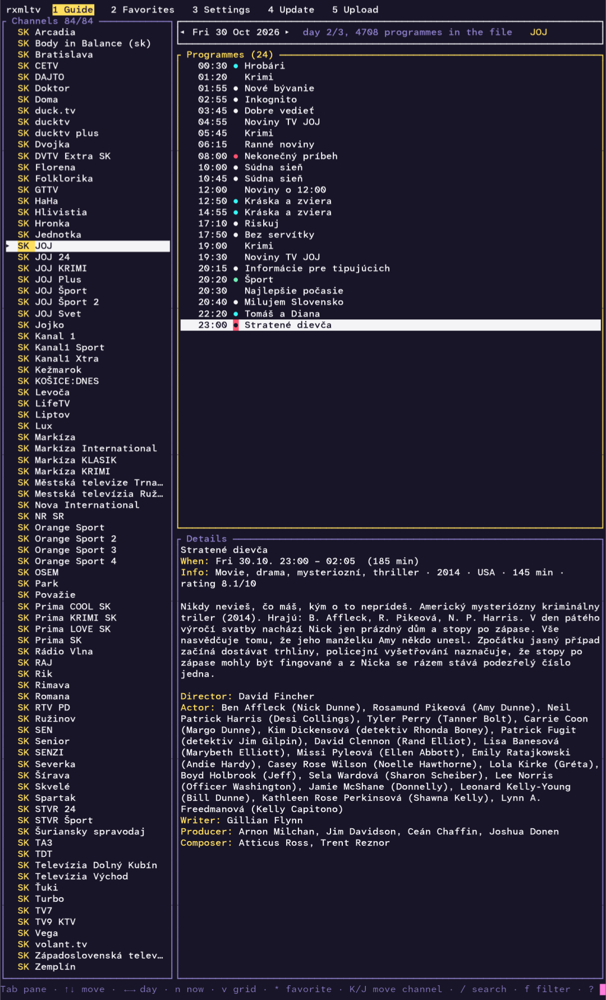
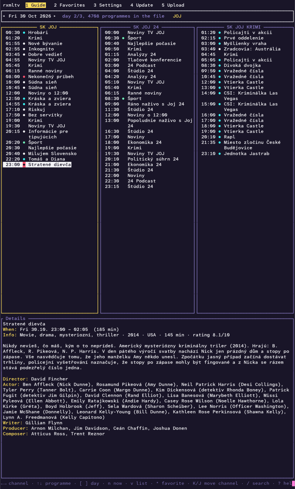
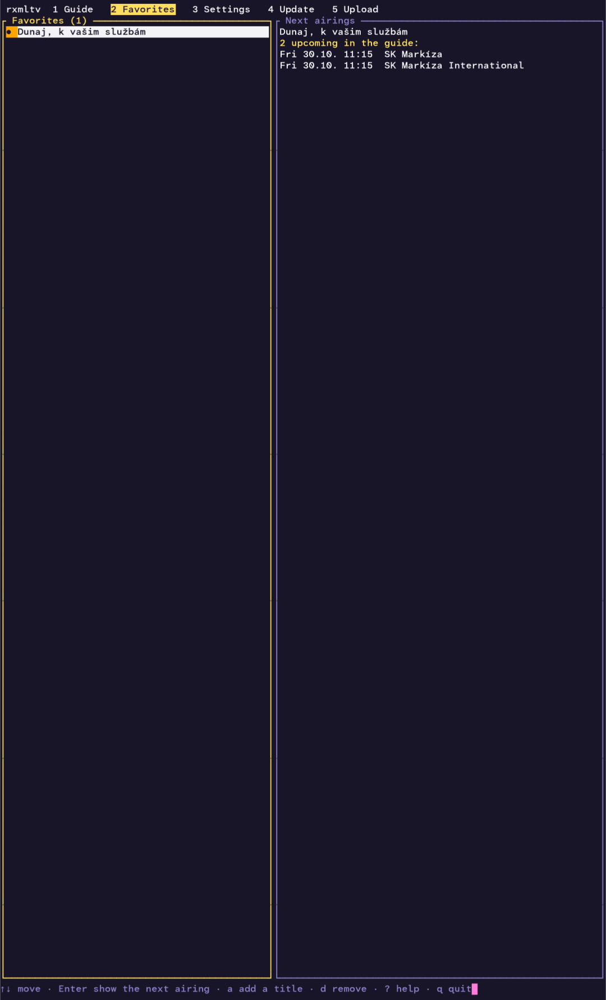
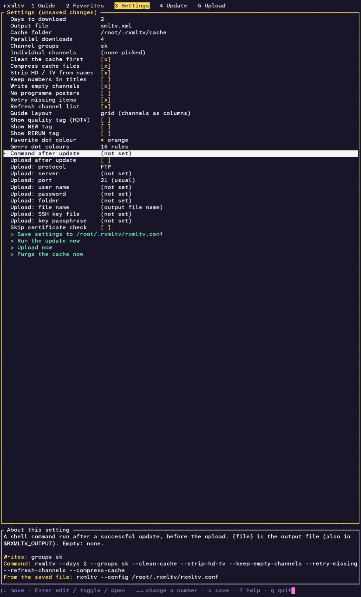
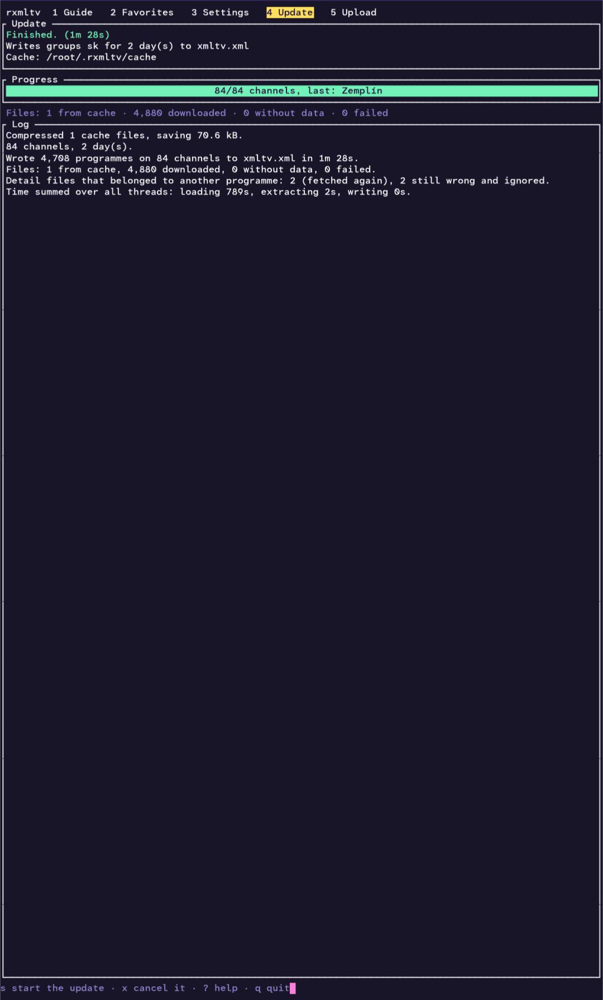
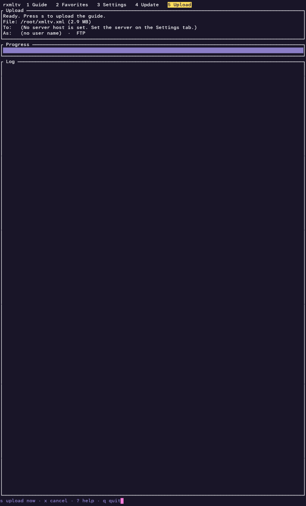

# rxmltv

[English](README.md) · **Čeština** · [Slovenčina](README.sk.md)

Generuje programového průvodce (EPG) ve formátu [XMLTV](https://wiki.xmltv.org/) pro české a slovenské televizní
stanice, k použití v Kodi, Jellyfinu, TVHeadendu, Plexu a podobných programech. Stažené soubory se ukládají na disk
do mezipaměti, takže další běhy stahují jen to, co je nové.

Jde o port původního nástroje sharpxmltv z C# do Rustu. Příkazová řádka i formát výstupu jsou stejné.

## Instalace

Stáhněte si archiv pro svůj systém ze stránky [Releases](../../releases) a rozbalte ho:

| Systém  | Procesor | Soubor |
|---------|----------|--------|
| Linux (statický, libovolná distribuce) | x86-64 | `rxmltv-<verze>-linux-x64.tar.gz` |
| | ARM64 | `rxmltv-<verze>-linux-arm64.tar.gz` |
| | ARMv7 (32bitový, hardwarová pohyblivá řádová čárka) | `rxmltv-<verze>-linux-armv7.tar.gz` |
| | RISC-V 64 | `rxmltv-<verze>-linux-riscv64.tar.gz` |
| | MIPS little-endian (mipsel, 32bitový) | `rxmltv-<verze>-linux-mipsel.tar.gz` |
| FreeBSD (sestaveno na 14, běží na 14.x a novějších) | x86-64 | `rxmltv-<verze>-freebsd-x64.tar.gz` |
| | ARM64 | `rxmltv-<verze>-freebsd-arm64.tar.gz` |
| Windows | x86-64 | `rxmltv-<verze>-win-x64.zip` |
| | ARM64 | `rxmltv-<verze>-win-arm64.zip` |
| macOS | Apple Silicon | `rxmltv-<verze>-macos-arm64.tar.gz` |
| | Intel | `rxmltv-<verze>-macos-x64.tar.gz` |

Balíčky pro **Debian, Ubuntu a příbuzné** (`.deb`) a pro **Fedoru, RHEL, openSUSE a příbuzné** (`.rpm`) jsou
k dispozici také pro x86-64, ARM64, ARMv7 (Debian `armhf`, RPM `armv7hl`), RISC-V 64 a mipsel:

```sh
sudo dpkg -i rxmltv_<verze>_amd64.deb          # nebo: sudo apt install ./rxmltv_<verze>_amd64.deb
sudo rpm -i rxmltv-<verze>-1.x86_64.rpm        # nebo: sudo dnf install ./rxmltv-<verze>-1.x86_64.rpm
```

Nainstalují `rxmltv` do `/usr/bin` a dokumentaci do `/usr/share/doc/rxmltv`. Program je stejné statické sestavení
jako v archivu tar.gz, takže balíčky nemají žádné závislosti; `curl` je jen doporučený (používá se pro nahrávání).
Nastavení a mezipaměť zůstávají pro každého uživatele zvlášť v `~/.rxmltv`.

Sestavení pro mipsel je experimentální: Rust pro něj nemá předpřipravenou standardní knihovnu, proto se sestavuje
nightly Rustem s volbou `-Zbuild-std`. Pokud se toto sestavení pokazí, vydání prostě vyjde bez souborů pro mipsel.
Je to statický program s programovou pohyblivou řádovou čárkou, který běží na každém little-endian systému MIPS32r2
s Linuxem, s FPU i bez (včetně většiny routerů s OpenWrt). Na 32bitových systémech jsou čítače v závěrečném souhrnu
běhu 32bitová; jinak se nic neliší.

Pro Windows, macOS ani FreeBSD sestavení pro RISC-V neexistuje: Windows a macOS pro RISC-V nejsou a cílová platforma
Rustu pro FreeBSD na RISC-V zatím nemá cestu přes CI.

V macOS Gatekeeper stažený program zablokuje. Po rozbalení to jednou zrušte:
`xattr -d com.apple.quarantine rxmltv`.

U každého vydání se zveřejňuje `SHA256SUMS.txt`. Nic dalšího není potřeba instalovat.

## Použití

```
rxmltv [volby]
```

| Volba | Význam |
|-------|--------|
| `--days <n>` | Kolik dní stáhnout, počínaje dneškem (výchozí 7) |
| `--output <soubor>` | Výstupní soubor (výchozí `xmltv.xml`). Název končící na `.gz` se zapíše komprimovaně (gzip) |
| `--cache-dir <složka>` | Složka mezipaměti (výchozí `~/.rxmltv/cache`; úvodní `~` je domovská složka) |
| `--lang <en\|cs\|sk>` | Jazyk rozhraní (výchozí: podle `LC_ALL` / `LANG`, jinak angličtina) |
| `--service` | Běh jako služba bez terminálového rozhraní: aktualizuje v časech z `update_times`, posílá oznámení přes Apprise a sdílí přes HTTP, je-li zapnuto `service_serve` (viz níže a `docs/SERVICE.md`) |
| `--serve` | Po aktualizaci sdílet výstupní soubor přes HTTP, dokud nestisknete Ctrl+C (viz níže) |
| `--no-update` | S `--serve`: neaktualizovat, jen sdílet existující soubor |
| `--port <n>` | Port serveru HTTP (výchozí 8080) |
| `--bind <adresa>` | Adresa, na které server HTTP naslouchá (výchozí `0.0.0.0`) |
| `--no-slovak-genres` | Nepřidávat do souboru XMLTV slovenské názvy za žánry |
| `--no-english-genres` | Nepřidávat do souboru XMLTV anglické názvy za české žánry (viz níže) |
| `--compress-cache` | Ukládat soubory mezipaměti komprimované (gzip) a zkomprimovat i existující, aby se ušetřilo místo na disku |
| `--purge-cache` | Nejdřív smazat všechny soubory z mezipaměti (i seznam stanic), pak aktualizovat |
| `--clean-cache` | Smazat soubory z mezipaměti starší než dnes, prošlé značky „žádná data“ a zbylé dočasné soubory |
| `--concurrency <n>` | Počet souběžných stahování, 1 až 64 (výchozí 4) |
| `--groups <a,b,c>` | Jen tyto skupiny stanic, podle názvu nebo kódu, např. `"České,Slovenské"` nebo `cz,sk`. Výchozí: všechny skupiny |
| `--channels <a,b,c>` | Vybrat jednotlivé stanice podle XMLTV id, např. `cz-ct1-2,sk-markiza-7` (viz `--list-channels`). `id=noveid` zapíše stanici pod jiným XMLTV id, např. `cz-ct1-2=ct1.cz`. V kombinaci s `--groups` dostanete oba výběry |
| `--channels-file <soubor>` | Totéž, jedna položka na řádek; řádky začínající `#` se ignorují a za id se ignoruje vše kromě `=noveid`, takže řádky z `--list-channels` můžete vložit tak, jak jsou. Lze opakovat |
| `--list-channels` | Vypíše všechny stanice (XMLTV id a název), abyste věděli, co zadat do `--channels`, a skončí |
| `--strip-hd-tv` | Odstraní samostatná slova `HD` a `TV` z názvů stanic a z XMLTV id, která se z nich tvoří: `Nova HD` se změní na `Nova`, `TV Barrandov` na `Barrandov`. Slova, která jsou součástí delšího slova (`HDTV`), zůstanou. Id zadaná do `--channels` pak musí být ta zkrácená, takže použijte stejný přepínač i s `--list-channels` |
| `--list-groups` | Vypíše skupiny, které server nabízí, s počty stanic, a skončí |
| `--keep-title-numbers` | Ponechá `(3)`, `(2/6)` a římská čísla řad v názvu. Výchozí: odstraní se a zapíšou se jako `<episode-num>` |
| `--keep-empty-channels` | Zapíše i stanice bez pořadů |
| `--no-images` | Nezapisuje prvky `<icon>` s plakáty pořadů |
| `--config <soubor>` | Nejdřív načte nastavení ze souboru (zapsaného přes `--tui`); volby z příkazové řádky ho přepíší, `--channels` přidá stanice k těm ze souboru. Úvodní `~` je domovská složka (i v `--config=~/...`). `--tui` a `--service` si `~/.rxmltv/rxmltv.conf` načtou samy, pokud existuje; obyčejný běh čte jen soubor, který mu určíte |
| `--tui` | Otevře terminálové rozhraní (viz níže) |
| `--post-command <příkaz>` | Po úspěšné aktualizaci spustí příkaz shellu; `{file}` je výstupní soubor |
| `--upload` | Po aktualizaci nahraje výstupní soubor (nastavení serveru se bere z `--config` / `--tui`; vyžaduje `curl`) |
| `--refresh-channels` | Znovu stáhne seznam stanic místo uloženého `channels.xml`, který se jinak nikdy neobnovuje (`--clean-cache` se ho nedotkne). Pokud stažení selže, běh skončí; starý soubor je už smazaný, takže spusťte program znovu |
| `--retry-missing` | Znovu se zeptá serveru na položky, pro které neměl data (jinak se 12 hodin přeskakují) |
| `-h`, `--help` | Zobrazí nápovědu |

`--volba=hodnota` funguje stejně jako `--volba hodnota`.

### Příklady

```sh
# Které skupiny existují
rxmltv --list-groups

# České a slovenské stanice, 7 dní, komprimovaně
rxmltv --groups cz,sk --output /var/www/epg/guide.xml.gz

# Jen zítřejší program, nejdřív uklidit mezipaměť
rxmltv --days 2 --clean-cache
```

Jednotlivé stanice vyberete podle jejich XMLTV id (to je `id` použité ve výstupu; velikost písmen se nerozlišuje):

```sh
rxmltv --list-channels                       # vypíše "cz-ct1-2  ČT1" a tak dále
rxmltv --channels cz-ct1-2,cz-nova-5,sk-markiza-7
rxmltv --groups sk --channels cz-nova-5      # všechny slovenské stanice plus Nova
rxmltv --channels-file my-channels.txt
```

`my-channels.txt` (řádky z `--list-channels` lze vložit, název za id se ignoruje):

```
# jedno XMLTV id na řádek
cz-ct1-2
cz-nova-5     Nova
sk-markiza-7
# "= noveid" zapíše stanici pod vaším vlastním id (např. aby odpovídalo existujícímu mapování EPG)
cz-prima-4 = prima.cz
```

Nové id se do výstupu zapíše beze změny (`<channel id="prima.cz">` a `<programme channel="prima.cz">`).
Funguje i u stanic, které přicházejí přes `--groups`. Dvě stanice nesmějí skončit se stejným id;
pokud ano, program skončí s chybou.

Spouštějte ho jednou nebo dvakrát denně. Například pomocí cronu:

```
30 4 * * * /usr/local/bin/rxmltv --groups cz,sk --clean-cache --output /var/www/epg/guide.xml.gz
```

> **Poznámka:** první běh může být pomalý. Každý pořad má vlastní soubor s podrobnostmi, takže úplné stažení všech
> stanic znamená desítky tisíc požadavků a mezipaměť je na začátku prázdná. Další běhy stahují jen novinky a jsou
> mnohem rychlejší, pokud používáte stále stejnou `--cache-dir`. První běh urychlíte omezením pomocí `--groups` nebo
> `--channels`, menším počtem `--days` nebo mírným zvýšením `--concurrency` (buďte ohleduplní k serveru). Je
> bezpečné ho přerušit klávesami Ctrl+C a spustit znovu: už stažené soubory se zachovají.

### Terminálové rozhraní

```sh
rxmltv --tui                    # nastavení se čte z ~/.rxmltv/rxmltv.conf a ukládá se tam
rxmltv --tui --config my.conf   # použije jiný soubor nastavení
```

**Kam se ukládají soubory:** všechno, co rxmltv vytváří pro vlastní potřebu, leží ve skryté složce `~/.rxmltv`
(ve Windows `%USERPROFILE%\.rxmltv`): `rxmltv.conf` (nastavení), `rxmltv.favorites`, `rxmltv.order` a složka `cache/`.
Vygenerovaný program (`--output`, výchozí `xmltv.xml`) se zapíše tam, kam určíte. `rxmltv.conf` ponechaný
v aktuální složce starší verzí se dál používá, pokud `~/.rxmltv/rxmltv.conf` neexistuje. Stará výchozí mezipaměť
`data/cache/` se už nepoužívá; pokud tam ještě je, smažte ji.

| | |
|---|---|
| **Program**, rozložení seznam | **Program**, rozložení mřížka |
|  |  |
| **Oblíbené** | **Nastavení** |
|  |  |
| **Aktualizace** | **Nahrání** |
|  |  |

(Snímky obrazovky ukazují anglické rozhraní.)

Sedm karet (`1`-`7` nebo F1-F7; `?` ukáže všechny klávesy; `q` ukončí):

- **Program**: prohlíží vygenerovaný soubor XMLTV (`--output`, prostý nebo `.gz`). Vlevo stanice (s kódem země
  velkými písmeny), vpravo pořady jednoho dne, dole podrobnosti. `Tab` mění panel, `←`/`→` mění den,
  `n` skočí na to, co běží teď (seznam se posune tak, aby byly vidět dva pořady před ním a hlavně to, co bude následovat),
  `p` skočí na hlavní vysílací čas, `/` hledá názvy pořadů ve všech stanicích, `f` filtruje seznam stanic, `r` znovu načte soubor.
  - **Rozložení mřížka** (přepíná `v`, nebo Nastavení > Rozložení programu): jeden sloupec na stanici jako v novinovém
    přehledu, pořady dne (čas a název) jsou vypsány pod sebou v každém sloupci a podrobnosti jsou dole. `←`/`→`
    vybírají stanici, `↑`/`↓` pořad (sloupce se posouvají společně, takže stejný čas zůstává u všech stanic
    na stejné úrovni), `[`/`]` mění den. Sloupce jsou široké nejméně 28 znaků; zobrazí se, kolik se jich vejde.
  - Seznam pořadů má sloupce: `>` pro to, co běží teď, **tečku oznámení** (barva v Nastavení), čas,
    **tečku oblíbeného**, název. **Tečky žánrů** jsou
    u pravého okraje: jedna tečka za každé pravidlo žánru (Nastavení > Barvy teček žánrů), které na pořad
    sedí, takže detektivní seriál jich může mít několik. Štítky `HDTV`, `NEW` a `RERUN` za názvem
    a kód země před názvy stanic lze v Nastavení vypnout.
  - **Hlavní vysílací čas** (Nastavení > Hlavní vysílací čas, výchozí 20:00): pořad, který v tu dobu běží, je v seznamu
    i v mřížce zvýrazněn žlutě (vypnete v Nastavení > Zvýrazňovat hlavní vysílací čas) a klávesa `p` na něj skočí.
  - `*` přidá nebo odebere vybraný pořad z oblíbených (porovnává se podle názvu, bez ohledu na velikost písmen a diakritiku).
  - `b` přidá nebo odebere oznámení pro vybraný pořad (viz Oznámení níže).
  - `K` / `J` (nebo Shift+Nahoru / Shift+Dolů) posunou vybranou stanici v seznamu stanic nahoru nebo dolů. Pořadí se
    pamatuje v `rxmltv.order` vedle souboru nastavení (smažte ho, chcete-li se vrátit k pořadí ze souboru).
- **Oblíbené**: oblíbené pořady (uložené v `rxmltv.favorites`) s jejich nejbližším vysíláním z načteného programu.
  `Enter` ukáže nejbližší vysílání v programu, `a` přidá název ručně, `d` jeden odebere.
- **Nastavení**: volby aktualizace jako nabídka: dny, výstupní soubor, složka mezipaměti, souběžná stahování, přepínače,
  výběr skupin stanic a výběr jednotlivých stanic (s případným vlastním XMLTV id, jako
  `--channels id=noveid`; `R` znovu stáhne seznam stanic), volby zobrazení (štítky, barva oblíbených,
  editor barev teček žánrů: klíčové slovo a barva, vyhrává první shoda, a vypisuje žánry nalezené v programu),
  příkaz spouštěný po aktualizaci a nastavení nahrávání. `s` uloží nastavení. Panel dole
  ukazuje stejné nastavení jako příkazovou řádku a jako `rxmltv --config <soubor>`.
- **Aktualizace**: spustí aktualizaci (pak příkaz a nahrání, jsou-li nastaveny) s ukazatelem průběhu, čítači souborů a záznamem;
  `x` ji zruší. Po dokončení se program znovu načte.
- **Nahrání**: odešle výstupní soubor na server hned, s ukazatelem průběhu a záznamem; `x` zruší.
- **Sdílení**: spouští a zastavuje server HTTP, který sdílí výstupní soubor (viz níže).
- **Oznámení**: seznam pořadů, které vám dají vědět, i s jejich volbami (viz níže).

Aktualizaci z cronu s uloženým nastavením spustíte bez terminálového rozhraní:

```
30 4 * * * /usr/local/bin/rxmltv --config /etc/rxmltv.conf
```

#### Sdílení programu přes HTTP

rxmltv umí vygenerovaný soubor sám poskytovat, takže si ho mediální server, TV box nebo jiný počítač může stáhnout z adresy URL:

```sh
rxmltv --serve                      # aktualizuje a pak sdílí http://<tento počítač>:8080/xmltv.xml
rxmltv --serve --no-update --port 9000   # jen sdílí existující soubor na portu 9000
rxmltv --serve --bind 127.0.0.1     # připojit se smí jen tento počítač
```

Vypíše adresy k použití a zaznamenává každý požadavek; Ctrl+C ho zastaví. V terminálovém rozhraní Nastavení > Sdílet přes HTTP
(`tui_serve = true` v souboru nastavení) sdílí soubor, dokud je rozhraní otevřené; karta **Sdílení** (`6`) ukazuje
adresy a záznam požadavků a `s` sdílení spouští a zastavuje. Změněný port nebo adresa server hned restartuje.

- Server odpovídá na `GET` a `HEAD` pro právě jeden soubor, pojmenovaný podle výstupního souboru (`/xmltv.xml`, `/epg.xml.gz`),
  a na malou úvodní stránku na `/`. Nelze se ho zeptat na žádný jiný soubor. Výstup `.gz` se poskytuje jako `application/gzip`.
- Rozumí hlavičkám `If-None-Match` a `If-Modified-Since`, takže klient, který se dotazuje opakovaně, stáhne jen změněný program.
  Soubor se čte při každém požadavku, takže aktualizace dokončená za běhu serveru se sdílí hned.
- **Není tu žádné heslo ani TLS.** Kdokoli, kdo se dostane k portu, si může program stáhnout. Používejte ho v důvěryhodné
  síti, nebo použijte `--bind 127.0.0.1` za reverzní proxy (nginx, Caddy) kvůli řízení přístupu a https. Porty
  pod 1024 obvykle vyžadují zvláštní oprávnění.
- `--serve` záměrně není volbou souboru nastavení, takže soubor z `--config` nikdy nemůže změnit úlohu v cronu v server,
  který neskončí. Pro trvalou službu použijte jednotku systemd, například
  `ExecStart=/usr/bin/rxmltv --config /etc/rxmltv.conf --serve --no-update`, a aktualizujte pomocí cronu nebo časovače.

#### Oznámení

Pořad vám může dát vědět před začátkem. Stiskněte `b` u pořadu v programu (nebo přidejte název na kartě
**Oznámení**, `7`) a rxmltv vás upozorní `notify_minutes` (výchozí 5) minut před začátkem:

- jako **vyskakovací okno** v terminálovém rozhraní (zavře se klávesou Enter), případně se **zvukem** (pípnutí terminálu);
- a/nebo přes [Apprise](https://appriseit.com/), které dosáhne na Telegram, e-mail, Discord, Pushover, ntfy a asi sto dalších
  služeb. Nainstalujte `apprise`, zadejte adresy v Nastavení > Adresy Apprise (nebo nechte `apprise_command` použít vlastní
  konfiguraci Apprise), zapněte Oznámení: Apprise a vyzkoušejte Nastavení > Poslat zkušební oznámení.

Stiskněte `b` u pořadu v programu. Pokud ještě nemá oznámení, otevře se dialog s otázkami:

- **jednou** (jen toto vysílání) nebo **pokaždé** (toto vysílání a všechna další);
- u „pokaždé“: jen **tato stanice**, nebo **všechny stanice**;
- pokud pořad **už běží** (nebo skončil): zda nastavit oznámení pro **jen nejbližší další vysílání**, pro **všechna
  nadcházející vysílání**, nebo **žádné**.

Stisk `b` u pořadu, který oznámení má, ho odstraní. Karta Oznámení je vypisuje všechna, s minutami před začátkem (prázdné =
výchozí), a umožňuje je měnit: `r` jednou/pokaždé, `c` tato stanice/všechny, `m` minuty, `R` znovu aktivuje dokončené.
Výchozí volby dialogu jsou v Nastavení (Oznámení: opakování, Oznámení: stanice, Oznámit minut předem). Oznámení „jednou“
je po oznámení hotové. Pořady s oznámením mají před časem barevnou tečku (Nastavení > Barva oznámení): oznámení „jednou“
označuje to jedno vysílání, oznámení „pokaždé“ své vysílání a všechna další.

Seznam se ukládá do `~/.rxmltv/rxmltv.notifications`, co už bylo oznámeno, do `~/.rxmltv/rxmltv.notified`.

Oznámení přes Apprise fungují i při běhu rxmltv jako služby, bez přihlášeného uživatele (níže). Pokud běží terminálové
rozhraní i služba, oznámí pořad ten, kdo si ho všimne první; rozhraní přesto ukáže své okno.

#### Běh jako služba

`rxmltv --service` běží bez terminálového rozhraní, dokud ho nezastavíte. Aktualizuje program v časech z `update_times`
(výchozí `04:00`, místní čas; aktualizace zmeškaná při vypnutém počítači se dohoní při spuštění služby), sdílí ho přes HTTP,
je-li `service_serve = true`, a posílá oznámení přes Apprise. Zůstává na popředí: spouští a hlídá ho systemd, launchd, rc.d
nebo Windows.

Podrobné postupy, ukázkové soubory služby a příklad nastavení jsou v **[docs/SERVICE.md](docs/SERVICE.md)** (anglicky)
a v [`packaging/service/`](packaging/service/): Linux (systemd, jako systémová služba s vlastním uživatelem nebo jako služba
vlastního uživatele bez root), macOS (launchd agent a daemon), FreeBSD (rc.d a cron bez root), Windows (Plánovač úloh bez
administrátora, nebo skutečná služba přes NSSM) a OpenRC. Například služba vlastního uživatele na Linuxu:

```sh
mkdir -p ~/.config/systemd/user
cp packaging/service/systemd/rxmltv-user.service ~/.config/systemd/user/rxmltv.service
systemctl --user enable --now rxmltv
sudo loginctl enable-linger "$USER"      # nechá ji běžet i po odhlášení
```

#### Jazyk

Terminálové rozhraní a zprávy při běhu jsou k dispozici v **angličtině, češtině a slovenštině**. Jazyk se bere
z prostředí (`LC_ALL`, `LC_MESSAGES`, `LANG`: `cs_CZ.UTF-8` dá češtinu, `sk_SK.UTF-8` slovenštinu, cokoli jiného angličtinu),
pokud ho nezvolíte sami: `--lang cs`, `language = cs` v souboru nastavení, nebo Nastavení > Jazyk (mění celé
rozhraní najednou). Názvy dnů a měsíců se řídí jazykem a stejně tak **názvy žánrů** v programu: v češtině
nebo slovenštině vidíte žánry v tomto jazyce, v angličtině anglické názvy (žánry, které nejsou ve vestavěném
seznamu, se zobrazí tak, jak je dává server). `--help` a zprávy o chybných argumentech příkazové řádky
zůstávají anglicky.

#### Žánry v souboru XMLTV

Každý `<category>` dostane velké první písmeno (`akční` se změní na `Akční`). Za každý žánr se známým
překladem se přidá anglické `<category lang="en">` a slovenské `<category lang="sk">`, například `Akční`
a za ním `Action` a `Akčný`, `Dobrodružný` a za ním `Adventure` (slovenské slovo je stejné, proto se neopakuje).
Typ od serveru (`Movie`, `Series`, `Documentary` ...) je anglický; dostane slovenský název (`Film`,
`Seriál`, `Dokumentárny`) a v angličtině se neopakuje. Přeloženo je asi 70 běžných žánrů; ostatní zůstanou,
jak jsou. Překlady vypnete pomocí `--no-english-genres` / `--no-slovak-genres` nebo v Nastavení (velká
počáteční písmena zůstanou). Program ukazuje každý žánr v jazyce rozhraní (viz Jazyk výše) a pravidla teček žánrů
se shodují s kterýmkoli jazykem, takže jako klíčová slova fungují `action`, `akční` i `akčný`.

#### Po aktualizaci: příkaz a nahrání

Obojí funguje z terminálového rozhraní i z příkazové řádky (`--post-command`, `--upload` nebo soubor nastavení).
Po úspěšné aktualizaci rxmltv nejdřív spustí příkaz a pak nahraje soubor. Pokud příkaz selže, nahrání se přeskočí.
Pokud selže cokoli z toho, program je přesto zapsán a návratový kód je 3.

- **Příkaz**: spouští ho shell (`sh -c`, ve Windows `cmd /C`). `{file}` v něm se změní na cestu k výstupnímu
  souboru (v uvozovkách), která je také v proměnné prostředí `RXMLTV_OUTPUT`. Co příkaz vypíše, jde do záznamu.
  Příklad: `--post-command 'xmltv-tool --in {file} --out /srv/epg/final.xml'`.
- **Nahrání**: FTP, FTPS (FTP s TLS), SFTP (SSH) a WebDAV (`webdav` = http, `webdavs` = https), s uživatelským
  jménem, heslem, portem, složkou, názvem souboru na serveru a pro SFTP souborem s klíčem SSH (vybírá se
  prohlížečem souborů v rozhraní) a jeho heslem. Přenos provádí program **`curl`**, který musí být nainstalován
  (Windows 10+ ho má). Díky tomu rxmltv neobsahuje žádný kód pro TLS ani SSH. Tajné údaje se předávají programu curl
  na standardní vstup, nikdy na příkazové řádce.
  - Heslo se ukládá do souboru nastavení jako prostý text (soubor dostane na Linuxu/macOS režim 600). Nechte
    ho prázdné a nastavte `RXMLTV_UPLOAD_PASSWORD`, aby zůstalo mimo soubor.
  - Složka s úvodním `/` je absolutní cesta (FTP, SFTP); jinak je relativní ke složce po přihlášení.
    Složky FTP a SFTP se vytvářejí, pokud chybějí; složky WebDAV musí existovat.
  - „Přeskočit kontrolu certifikátu“ vypne ověřování certifikátu TLS (FTPS, https) a kontrolu hostitelského klíče SSH (SFTP).
    Bez něj musí být server SFTP ve vašem `known_hosts` (jednou se k němu připojte přes `ssh` nebo `sftp`, aby se přidal).

Soubor nastavení je prostý text, jeden `klíč = hodnota` na řádek: `days`, `output`, `cache_dir`, `concurrency`,
`groups`, opakované `channel`, volby ano/ne `clean_cache`, `strip_hd_tv`, `keep_title_numbers`,
`keep_empty_channels`, `no_images`, `retry_missing`, `refresh_channels`, `compress_cache`, `english_genres`, `slovak_genres`, `tui_serve`, `serve_port`, `serve_bind`, `update_times`, `service_serve`, `notify_popup`, `notify_sound`, `notify_apprise`, `apprise_command`, `apprise_urls`, `notify_minutes`, `notify_repeat`, `notify_scope`, `notify_color`, `language` (`en`, `cs` nebo `sk`), volby zobrazení `show_country`, `show_quality`,
`show_new`, `show_rerun`, `primetime` (`HH:MM`), `highlight_primetime`, `guide_layout` (`list` nebo `grid`), `favorite_color`, opakované `genre_color = klíčové slovo = barva`, a `post_command` a
nastavení `upload_*` (`upload_after_update`, `upload_protocol`, `upload_host`, `upload_port`, `upload_user`,
`upload_password`, `upload_folder`, `upload_name`, `upload_key`, `upload_key_passphrase`, `upload_insecure`).
Barvy jsou názvy (`red`, `orange`, `lightblue` ...) nebo `#rrggbb`.

Terminálové rozhraní je součást sestavení a je ve výchozím stavu zapnuté. `cargo build --release --no-default-features` ho vynechá.

### Kódy skupin

Id stanic ve výstupu vypadají jako `cz-ct1-2` (`<kód skupiny>-<název>-<id>`). Známé skupiny dostanou krátký kód:
`cz` (České), `sk`, `en`, `de`, `pl`, `fr`, `hu`, `it`, `ru`, `es` a `others` (Ostatní). Každá jiná skupina použije vlastní
název malými písmeny v ASCII. Názvy skupin se porovnávají bez ohledu na velikost písmen a diakritiku.

### Návratové kódy

| Kód | Význam |
|-----|--------|
| 0 | Úspěch |
| 1 | Seznam stanic se nepodařilo načíst, žádná stanice nevyhověla, nebo závažná chyba |
| 2 | Chybná příkazová řádka |
| 3 | Program byl zapsán, ale příkaz po aktualizaci nebo nahrání selhalo |
| 130 | Zrušeno (Ctrl+C / SIGTERM). Dočasné soubory se odstraní |

## Jak to funguje

- Stáhne seznam stanic, pak pro každou stanici a den výpis pořadů a soubor s podrobnostmi pro každý pořad.
- Všechno se ukládá do mezipaměti v `--cache-dir`. Soubor `.miss` označuje něco, k čemu server neměl data; po dobu
  12 hodin se na to znovu neptá (`--retry-missing` to změní).
- Soubor s podrobnostmi, který patří jinému pořadu než položka ve výpisu (zastaralá mezipaměť, změna programu), se stáhne
  znovu a pokud je stále špatný, ignoruje se.
- Strukturovaná data (herci, režisér, rok, žánr, hodnocení, příznaky jako HD / premiéra / repríza) se používají jako první.
  Zpracování textu názvů a popisů doplní jen to, co chybí.
- Časy pořadů se zapisují se skutečným posunem UTC pro Europe/Prague v daném dni.
- Spotřeba paměti zůstává stálá: stanice se zpracovávají po několika a hned po dokončení se zapisují do dočasného souboru.

## Sestavení ze zdrojového kódu

Vyžaduje Rust 1.80 nebo novější.

```sh
cargo test
cargo build --release      # program: target/release/rxmltv
```

Na FreeBSD: `pkg install rust` a pak stejné příkazy.

Výchozí sestavení nemá žádné závislosti na C, takže se snadno kříženě kompiluje (CI používá `cargo zigbuild` pro sestavení
pro Linux ARM64 a RISC-V). Komunikuje přes prosté `http://`, což server používá. Pokud by server někdy přesměroval na https,
sestavte pomocí `cargo build --release --features tls`.

## Vydání (pro správce)

GitHub Actions (`.github/workflows/build.yml`) sestaví program pro Linux, FreeBSD, Windows a macOS při každém pushi do
`main`. Vydání zveřejníte tak, že zvýšíte `version` v `Cargo.toml` a pak:

```sh
git tag v1.0.0
git push origin v1.0.0
```

Workflow připojí k novému vydání na GitHubu všechny archivy, balíčky `.deb` a `.rpm` (sestavené pomocí
[nfpm](https://nfpm.goreleaser.com/) z `packaging/nfpm.yaml`) a `SHA256SUMS.txt`.
Před prvním vydáním nastavte v `packaging/nfpm.yaml` skutečného správce (`maintainer`) a licenci (`license`).
