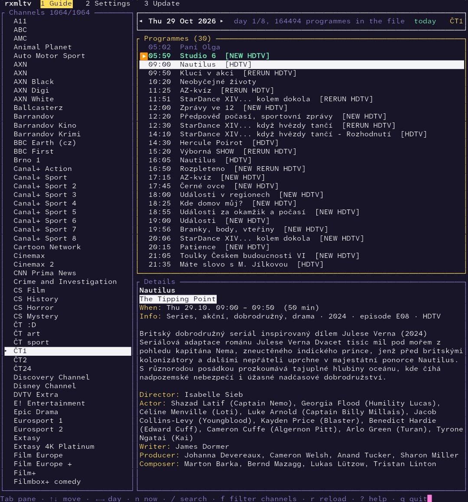
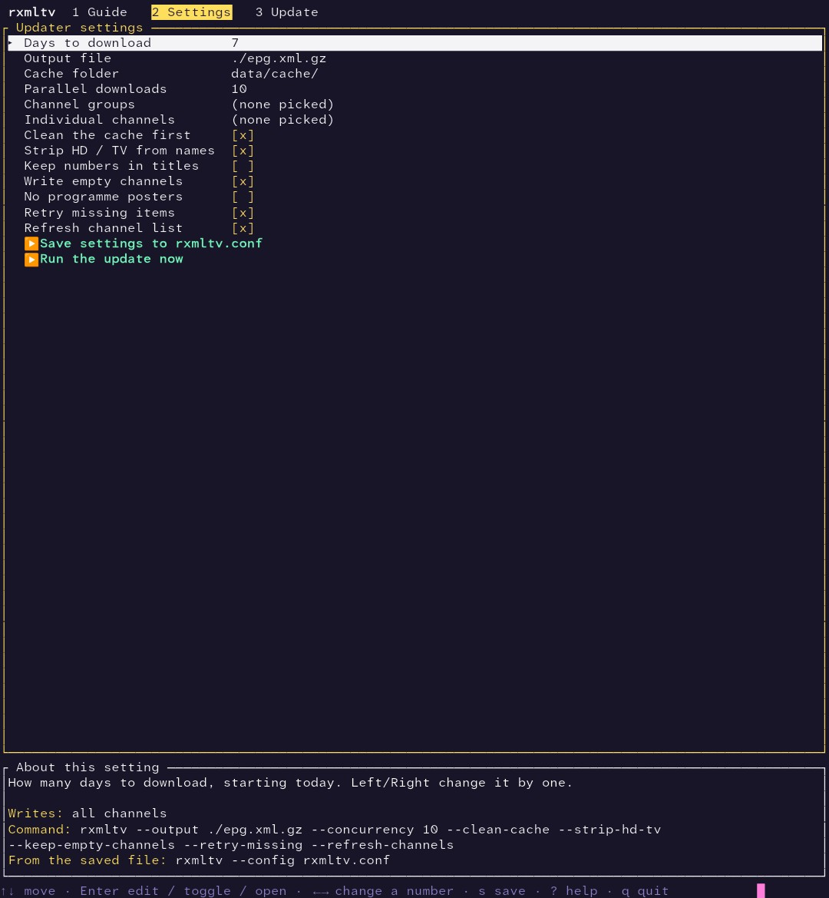

# rxmltv

Generates an [XMLTV](https://wiki.xmltv.org/) programme guide (EPG) for Czech and Slovak TV channels, for use with
Kodi, Jellyfin, TVHeadend, Plex and similar. Downloaded files are cached on disk, so repeated runs only fetch what
is new.

This is the Rust port of the original C# tool, sharpxmltv. The command line and the output format are the same.

## Install

Download the archive for your system from the [Releases](../../releases) page and unpack it:

| System  | CPU | File |
|---------|-----|------|
| Linux (static, any distribution) | x86-64 | `rxmltv-<version>-linux-x64.tar.gz` |
| | ARM64 | `rxmltv-<version>-linux-arm64.tar.gz` |
| | RISC-V 64 | `rxmltv-<version>-linux-riscv64.tar.gz` |
| FreeBSD (built on 14, runs on 14.x and newer) | x86-64 | `rxmltv-<version>-freebsd-x64.tar.gz` |
| | ARM64 | `rxmltv-<version>-freebsd-arm64.tar.gz` |
| Windows | x86-64 | `rxmltv-<version>-win-x64.zip` |
| | ARM64 | `rxmltv-<version>-win-arm64.zip` |
| macOS | Apple Silicon | `rxmltv-<version>-macos-arm64.tar.gz` |
| | Intel | `rxmltv-<version>-macos-x64.tar.gz` |

There is no RISC-V build for Windows, macOS or FreeBSD: Windows and macOS don't exist for RISC-V, and FreeBSD's
RISC-V Rust target has no CI route yet.

On macOS, a downloaded binary is quarantined by Gatekeeper. Clear that once after unpacking:
`xattr -d com.apple.quarantine rxmltv`.

`SHA256SUMS.txt` is published with every release. There is nothing else to install.

## Usage

```
rxmltv [options]
```

| Option | Meaning |
|--------|---------|
| `--days <n>` | Days to download, starting today (default 7) |
| `--output <file>` | Output file (default `xmltv.xml`). A name ending in `.gz` is written gzip-compressed |
| `--cache-dir <dir>` | Cache folder (default `~/.rxmltv/cache`; a leading `~` is the home folder) |
| `--compress-cache` | Store cache files gzip-compressed, and compress the existing ones, to save disk space |
| `--purge-cache` | Delete every cached file first (also the channel list), then update |
| `--clean-cache` | Delete cached files older than today, expired "no data" markers and leftover temp files |
| `--concurrency <n>` | Parallel downloads (default 4) |
| `--groups <a,b,c>` | Only these channel groups, by name or code, e.g. `"České,Slovenské"` or `cz,sk`. Default: all groups |
| `--channels <a,b,c>` | Pick individual channels by XMLTV id, e.g. `cz-ct1-2,sk-markiza-7` (see `--list-channels`). `id=newid` writes the channel under a different XMLTV id, e.g. `cz-ct1-2=ct1.cz`. Combined with `--groups`, you get both selections |
| `--channels-file <file>` | Same, one entry per line; lines starting with `#` are ignored, and after the id anything except `=newid` is ignored, so you can paste lines from `--list-channels` as they are. Can be repeated |
| `--list-channels` | Print every channel (XMLTV id and name) so you know what to put in `--channels`, then exit |
| `--strip-hd-tv` | Remove the separate words `HD` and `TV` from channel names and from the XMLTV ids built from them: `Nova HD` becomes `Nova`, `TV Barrandov` becomes `Barrandov`. Words that are part of a longer word (`HDTV`) are left alone. Ids given to `--channels` must then be the stripped ones, so use the same flag with `--list-channels` |
| `--list-groups` | Print the groups the server offers with channel counts, then exit |
| `--keep-title-numbers` | Keep `(3)`, `(2/6)` and roman season numbers in the title. Default: removed and written as `<episode-num>` |
| `--keep-empty-channels` | Also write channels that have no programmes |
| `--no-images` | Don't write programme poster `<icon>` elements |
| `--config <file>` | Read the settings from a file first (written by `--tui`); options on the command line override it, `--channels` adds to the file's channels |
| `--tui` | Open the terminal UI (see below) |
| `--post-command <cmd>` | Run a shell command after a successful update; `{file}` is the output file |
| `--upload` | Upload the output file after the update (server settings come from `--config` / `--tui`; needs `curl`) |
| `--refresh-channels` | Download the channel list again instead of using the cached `channels.xml`, which is otherwise kept forever (`--clean-cache` does not touch it). If the download fails, the run stops; the old copy is already removed, so run it again |
| `--retry-missing` | Ask the server again for items it had no data for (otherwise skipped for 12 hours) |
| `-h`, `--help` | Show help |

`--option=value` works as well as `--option value`.

### Examples

```sh
# See which groups exist
rxmltv --list-groups

# Czech and Slovak channels, 7 days, compressed
rxmltv --groups cz,sk --output /var/www/epg/guide.xml.gz

# Tomorrow's guide only, tidy the cache first
rxmltv --days 2 --clean-cache
```

Choose individual channels by their XMLTV id (the `id` used in the output; ignoring case):

```sh
rxmltv --list-channels                       # prints "cz-ct1-2  ČT1" and so on
rxmltv --channels cz-ct1-2,cz-nova-5,sk-markiza-7
rxmltv --groups sk --channels cz-nova-5      # all Slovak channels plus Nova
rxmltv --channels-file my-channels.txt
```

`my-channels.txt` (pasting lines from `--list-channels` works, the name after the id is ignored):

```
# one XMLTV id per line
cz-ct1-2
cz-nova-5     Nova
sk-markiza-7
# "= newid" writes the channel under your own id (e.g. to match an existing EPG mapping)
cz-prima-4 = prima.cz
```

The new id is written verbatim to the output (`<channel id="prima.cz">` and `<programme channel="prima.cz">`).
It also works for channels that come in through `--groups`. Two channels must not end up with the same id;
the program stops with an error if they do.

Run it once or twice a day. For example with cron:

```
30 4 * * * /usr/local/bin/rxmltv --groups cz,sk --clean-cache --output /var/www/epg/guide.xml.gz
```

> **Note:** the first run can be slow. Every programme has its own detail file, so a full download of all channels
> means tens of thousands of requests, and the cache starts empty. Later runs only fetch what is new and are much
> faster, as long as you keep the same `--cache-dir`. To speed up the first run, limit it with `--groups` or
> `--channels`, use fewer `--days`, or raise `--concurrency` a little (be considerate to the server). It is safe to
> interrupt with Ctrl+C and start again: files already downloaded are kept.

### Terminal UI

```sh
rxmltv --tui                    # settings are read from and saved to ~/.rxmltv/rxmltv.conf
rxmltv --tui --config my.conf   # use another settings file
```

**Where files go:** everything rxmltv creates for its own use lives in the hidden folder `~/.rxmltv` (on Windows
`%USERPROFILE%\.rxmltv`): `rxmltv.conf` (settings), `rxmltv.favorites`, `rxmltv.order` and the `cache/` folder.
The generated guide (`--output`, default `xmltv.xml`) is written where you say. An `rxmltv.conf` left in the current
folder by an earlier version is still used when `~/.rxmltv/rxmltv.conf` does not exist. The old default cache
`data/cache/` is no longer used; delete it if it is still there.



(The screenshots show an earlier version: the programme list now also has the favorite and genre dot columns and the channel list a country code column.)



Five tabs (`1`-`5` or F1-F5; `?` shows all keys; `q` quits):

- **Guide**: browses the generated XMLTV file (`--output`, plain or `.gz`). Channels (with their upper-case country
  code) on the left, one day's programmes on the right, details below. `Tab` changes pane, `←`/`→` change day,
  `n` jumps to now, `/` searches programme titles in every channel, `f` filters the channel list, `r` reloads.
  - **Grid layout** (`v` switches, or Settings > Guide layout): one column per channel like a newspaper listing, with
    the day's programmes (time and title) listed down each column and the details tab below. `←`/`→` pick the
    channel, `↑`/`↓` the programme (the columns scroll together, so the same time stays level across channels),
    `[`/`]` change day. Columns are at least 28 characters wide; as many as fit are shown.
  - The programme list has columns: `>` for what is on now, a **favorite dot**, the time, a **genre dot**, the title.
    The `HDTV`, `NEW` and `RERUN` tags after the title can be switched off in Settings.
  - `*` adds or removes the selected show as a favorite (matched by title, ignoring case and diacritics).
  - `K` / `J` (or Shift+Up / Shift+Down) move the selected channel up or down in the channel list. The order is
    remembered in `rxmltv.order` next to the settings file (delete it to go back to the file's order).
- **Favorites**: the favorite shows (kept in `rxmltv.favorites`) with their upcoming airings from the loaded guide.
  `Enter` shows the next airing in the Guide, `a` adds a title by hand, `d` removes one.
- **Settings**: the updater's options as a menu: days, output file, cache folder, parallel downloads, flags,
  a picker for channel groups and one for individual channels (with optional own XMLTV ids, like
  `--channels id=newid`; `R` fetches the channel list again), the display options (tags, favorite colour,
  an editor for the genre dot colours: keyword and colour, first match wins, and it lists the genres found in your
  guide), the command to run after an update, and the upload settings. `s` saves the settings. The panel below
  shows the same settings as a command line and as `rxmltv --config <file>`.
- **Update**: runs the update (then the command and the upload, if set) with a progress bar, file counters and log;
  `x` cancels. The guide reloads when it finishes.
- **Upload**: sends the output file to the server now, with a progress bar and log; `x` cancels.

Run an update from cron with the saved settings, no terminal UI needed:

```
30 4 * * * /usr/local/bin/rxmltv --config /etc/rxmltv.conf
```

#### After an update: command and upload

Both work from the terminal UI and from the command line (`--post-command`, `--upload`, or the settings file).
After a successful update rxmltv first runs the command, then uploads. If the command fails, the upload is skipped.
If either fails, the guide is still written and the exit code is 3.

- **Command**: run by the shell (`sh -c`, or `cmd /C` on Windows). `{file}` in it becomes the path of the output
  file (quoted), which is also in the `RXMLTV_OUTPUT` environment variable. What it prints goes to the log.
  Example: `--post-command 'xmltv-tool --in {file} --out /srv/epg/final.xml'`.
- **Upload**: FTP, FTPS (FTP with TLS), SFTP (SSH) and WebDAV (`webdav` = http, `webdavs` = https), with user
  name, password, port, folder, file name on the server, and for SFTP an SSH key file (chosen with a file browser in
  the UI) and its passphrase. The transfer is done by the **`curl`** program, which must be installed (Windows 10+
  has it). This keeps rxmltv free of TLS and SSH code. Secrets are given to curl on its standard input, never on its
  command line.
  - The password is stored in the settings file as plain text (the file gets mode 600 on Linux/macOS). Leave
    it empty and set `RXMLTV_UPLOAD_PASSWORD` to keep it out of the file.
  - A folder with a leading `/` is an absolute path (FTP, SFTP); otherwise it is relative to the login folder.
    FTP and SFTP folders are created if missing; WebDAV folders must exist.
  - "Skip certificate check" turns off TLS certificate verification (FTPS, https) and the SSH host key check (SFTP).
    Without it, an SFTP server must be in your `known_hosts` (connect once with `ssh` or `sftp` to add it).

The settings file is plain text, one `key = value` per line: `days`, `output`, `cache_dir`, `concurrency`,
`groups`, repeated `channel`, the yes/no options `clean_cache`, `strip_hd_tv`, `keep_title_numbers`,
`keep_empty_channels`, `no_images`, `retry_missing`, `refresh_channels`, `compress_cache`, the display options `show_quality`,
`show_new`, `show_rerun`, `guide_layout` (`list` or `grid`), `favorite_color`, repeated `genre_color = keyword = colour`, and `post_command` and the
`upload_*` settings (`upload_after_update`, `upload_protocol`, `upload_host`, `upload_port`, `upload_user`,
`upload_password`, `upload_folder`, `upload_name`, `upload_key`, `upload_key_passphrase`, `upload_insecure`).
Colours are names (`red`, `orange`, `lightblue` ...) or `#rrggbb`.

The UI is a build feature that is on by default. `cargo build --release --no-default-features` leaves it out.

### Group codes

Channel ids in the output look like `cz-ct1-2` (`<group code>-<name>-<id>`). Known groups get a short code:
`cz` (České), `sk`, `en`, `de`, `pl`, `fr`, `hu`, `it`, `ru`, `es`, and `others` (Ostatní). Any other group uses its own
name in lower-case ASCII. Group names are matched ignoring case and diacritics.

### Exit codes

| Code | Meaning |
|------|---------|
| 0 | Success |
| 1 | Channel list could not be loaded, no channels matched, or a fatal error |
| 2 | Bad command line |
| 130 | Cancelled (Ctrl+C / SIGTERM). Temporary files are removed |

## How it works

- Downloads the channel list, then for every channel and day the programme listing and a detail file per programme.
- Everything is cached in `--cache-dir`. A `.miss` file marks something the server had no data for; it is not asked
  for again for 12 hours (`--retry-missing` overrides this).
- A detail file that belongs to a different programme than the listing entry (stale cache, schedule changed) is fetched
  again and ignored if it is still wrong.
- Structured data (cast, director, year, genre, rating, flags such as HD / premiere / rerun) is used first. Text parsing
  of titles and descriptions only fills in what is missing.
- Programme times are written with the real Europe/Prague UTC offset for that date.
- Memory use stays flat: channels are processed a few at a time and written to a temporary file as they finish.

## Building from source

Needs Rust 1.80 or newer.

```sh
cargo test
cargo build --release      # binary: target/release/rxmltv
```

On FreeBSD: `pkg install rust`, then the same commands.

The default build has no C dependencies, so it cross-compiles easily (CI uses `cargo zigbuild` for the Linux ARM64 and
RISC-V builds). It talks plain `http://`, which is what the server uses. If the server ever redirects to https, build
with `cargo build --release --features tls`.

## Releases (maintainers)

GitHub Actions (`.github/workflows/build.yml`) builds for Linux, FreeBSD, Windows and macOS on every push to
`main`. To publish a release, bump `version` in `Cargo.toml`, then:

```sh
git tag v1.0.0
git push origin v1.0.0
```

The workflow attaches all archives and `SHA256SUMS.txt` to a new GitHub release.
