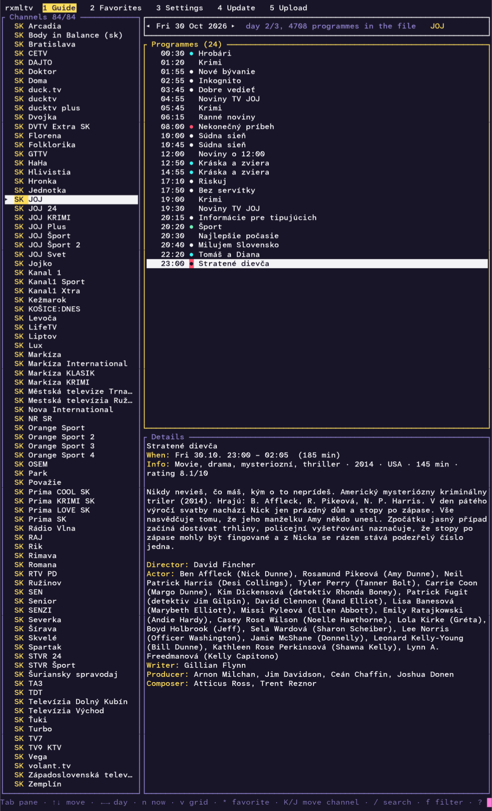
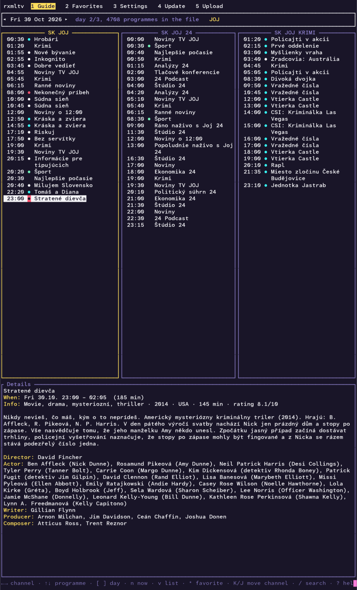
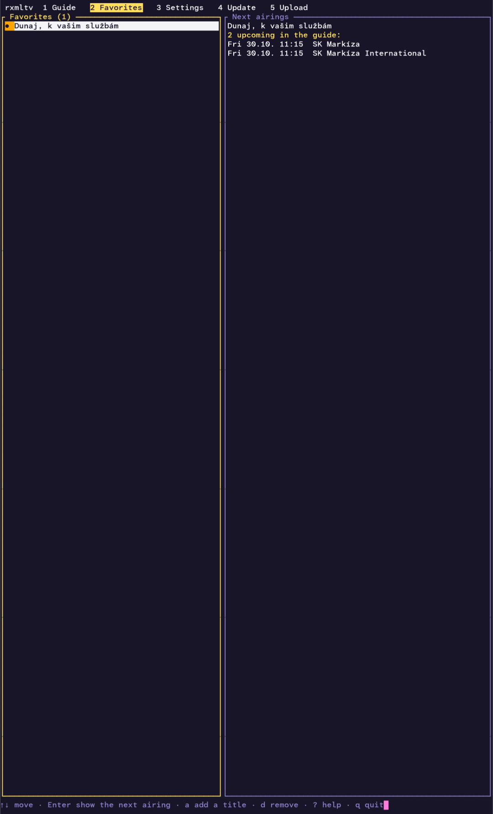
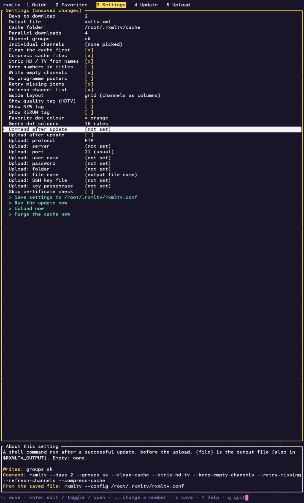
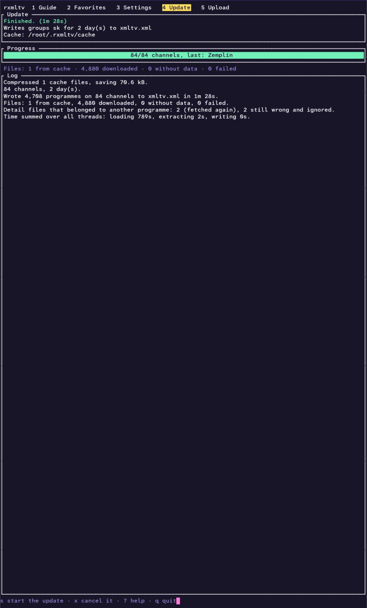
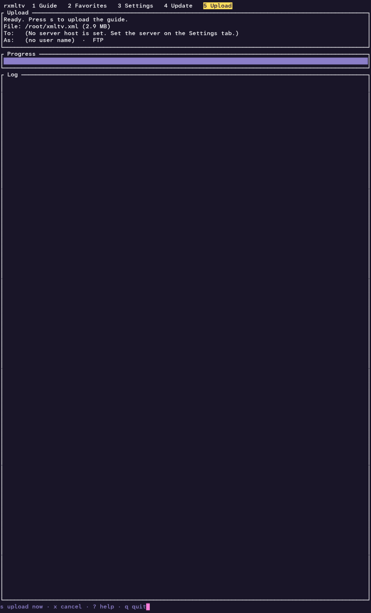

# rxmltv

[English](README.md) · [Čeština](README.cs.md) · **Slovenčina**

Generuje programového sprievodcu (EPG) vo formáte [XMLTV](https://wiki.xmltv.org/) pre české a slovenské televízne
stanice, na použitie v Kodi, Jellyfine, TVHeadende, Plexe a podobných programoch. Stiahnuté súbory sa ukladajú na disk
do vyrovnávacej pamäte, takže ďalšie behy sťahujú len to, čo je nové.

Ide o port pôvodného nástroja sharpxmltv z C# do Rustu. Príkazový riadok aj formát výstupu sú rovnaké.

## Inštalácia

Stiahnite si archív pre svoj systém zo stránky [Releases](../../releases) a rozbaľte ho:

| Systém  | Procesor | Súbor |
|---------|----------|-------|
| Linux (statický, ľubovoľná distribúcia) | x86-64 | `rxmltv-<verzia>-linux-x64.tar.gz` |
| | ARM64 | `rxmltv-<verzia>-linux-arm64.tar.gz` |
| | ARMv7 (32-bitový, hardvérová pohyblivá rádová čiarka) | `rxmltv-<verzia>-linux-armv7.tar.gz` |
| | RISC-V 64 | `rxmltv-<verzia>-linux-riscv64.tar.gz` |
| | MIPS little-endian (mipsel, 32-bitový) | `rxmltv-<verzia>-linux-mipsel.tar.gz` |
| FreeBSD (zostavené na 14, beží na 14.x a novších) | x86-64 | `rxmltv-<verzia>-freebsd-x64.tar.gz` |
| | ARM64 | `rxmltv-<verzia>-freebsd-arm64.tar.gz` |
| Windows | x86-64 | `rxmltv-<verzia>-win-x64.zip` |
| | ARM64 | `rxmltv-<verzia>-win-arm64.zip` |
| macOS | Apple Silicon | `rxmltv-<verzia>-macos-arm64.tar.gz` |
| | Intel | `rxmltv-<verzia>-macos-x64.tar.gz` |

Balíčky pre **Debian, Ubuntu a príbuzné** (`.deb`) a pre **Fedoru, RHEL, openSUSE a príbuzné** (`.rpm`) sú
k dispozícii aj pre x86-64, ARM64, ARMv7 (Debian `armhf`, RPM `armv7hl`), RISC-V 64 a mipsel:

```sh
sudo dpkg -i rxmltv_<verzia>_amd64.deb          # alebo: sudo apt install ./rxmltv_<verzia>_amd64.deb
sudo rpm -i rxmltv-<verzia>-1.x86_64.rpm        # alebo: sudo dnf install ./rxmltv-<verzia>-1.x86_64.rpm
```

Nainštalujú `rxmltv` do `/usr/bin` a dokumentáciu do `/usr/share/doc/rxmltv`. Program je rovnaké statické zostavenie
ako v archíve tar.gz, takže balíčky nemajú žiadne závislosti; `curl` je len odporúčaný (používa sa na nahrávanie).
Nastavenia a vyrovnávacia pamäť zostávajú pre každého používateľa zvlášť v `~/.rxmltv`.

Zostavenie pre mipsel je experimentálne: Rust pre neho nemá predpripravenú štandardnú knižnicu, preto sa zostavuje
nightly Rustom s voľbou `-Zbuild-std`. Ak sa toto zostavenie pokazí, vydanie jednoducho vyjde bez súborov pre mipsel.
Je to statický program so softvérovou pohyblivou rádovou čiarkou, ktorý beží na každom little-endian systéme MIPS32r2
s Linuxom, s FPU aj bez (vrátane väčšiny routerov s OpenWrt). Na 32-bitových systémoch sú počítadlá v záverečnom
súhrne behu 32-bitové; inak sa nič nelíši.

Pre Windows, macOS ani FreeBSD zostavenie pre RISC-V neexistuje: Windows a macOS pre RISC-V nie sú a cieľová platforma
Rustu pre FreeBSD na RISC-V zatiaľ nemá cestu cez CI.

V macOS Gatekeeper stiahnutý program zablokuje. Po rozbalení to raz zrušte:
`xattr -d com.apple.quarantine rxmltv`.

Pri každom vydaní sa zverejňuje `SHA256SUMS.txt`. Nič ďalšie netreba inštalovať.

## Použitie

```
rxmltv [voľby]
```

| Voľba | Význam |
|-------|--------|
| `--days <n>` | Koľko dní stiahnuť, počnúc dneškom (predvolene 7) |
| `--output <súbor>` | Výstupný súbor (predvolene `xmltv.xml`). Názov končiaci na `.gz` sa zapíše komprimovane (gzip) |
| `--cache-dir <priečinok>` | Priečinok vyrovnávacej pamäte (predvolene `~/.rxmltv/cache`; úvodná `~` je domovský priečinok) |
| `--lang <en\|cs\|sk>` | Jazyk rozhrania (predvolene: podľa `LC_ALL` / `LANG`, inak angličtina) |
| `--service` | Beh ako služba bez terminálového rozhrania: aktualizuje v časoch z `update_times`, posiela oznámenia cez Apprise a zdieľa cez HTTP, ak je zapnuté `service_serve` (pozri nižšie a `docs/SERVICE.md`) |
| `--serve` | Po aktualizácii zdieľať výstupný súbor cez HTTP, kým nestlačíte Ctrl+C (pozri nižšie) |
| `--no-update` | S `--serve`: neaktualizovať, len zdieľať existujúci súbor |
| `--port <n>` | Port servera HTTP (predvolene 8080) |
| `--bind <adresa>` | Adresa, na ktorej server HTTP počúva (predvolene `0.0.0.0`) |
| `--no-slovak-genres` | Nepridávať do súboru XMLTV slovenské názvy za žánre |
| `--no-english-genres` | Nepridávať do súboru XMLTV anglické názvy za české žánre (pozri nižšie) |
| `--compress-cache` | Ukladať súbory vyrovnávacej pamäte komprimované (gzip) a skomprimovať aj existujúce, aby sa ušetrilo miesto na disku |
| `--purge-cache` | Najprv zmazať všetky súbory z vyrovnávacej pamäte (aj zoznam staníc), potom aktualizovať |
| `--clean-cache` | Zmazať súbory z vyrovnávacej pamäte staršie ako dnes, prešlé značky „žiadne údaje“ a zvyšné dočasné súbory |
| `--concurrency <n>` | Počet súbežných sťahovaní, 1 až 64 (predvolene 4) |
| `--groups <a,b,c>` | Len tieto skupiny staníc, podľa názvu alebo kódu, napr. `"České,Slovenské"` alebo `cz,sk`. Predvolene: všetky skupiny |
| `--channels <a,b,c>` | Vybrať jednotlivé stanice podľa XMLTV id, napr. `cz-ct1-2,sk-markiza-7` (pozri `--list-channels`). `id=noveid` zapíše stanicu pod iným XMLTV id, napr. `cz-ct1-2=ct1.cz`. V kombinácii s `--groups` dostanete oba výbery |
| `--channels-file <súbor>` | To isté, jedna položka na riadok; riadky začínajúce `#` sa ignorujú a za id sa ignoruje všetko okrem `=noveid`, takže riadky z `--list-channels` môžete vložiť tak, ako sú. Dá sa opakovať |
| `--list-channels` | Vypíše všetky stanice (XMLTV id a názov), aby ste vedeli, čo zadať do `--channels`, a skončí |
| `--strip-hd-tv` | Odstráni samostatné slová `HD` a `TV` z názvov staníc a z XMLTV id, ktoré sa z nich tvoria: `Nova HD` sa zmení na `Nova`, `TV Barrandov` na `Barrandov`. Slová, ktoré sú súčasťou dlhšieho slova (`HDTV`), zostanú. Id zadané do `--channels` potom musia byť tie skrátené, takže použite rovnaký prepínač aj s `--list-channels` |
| `--list-groups` | Vypíše skupiny, ktoré server ponúka, s počtami staníc, a skončí |
| `--keep-title-numbers` | Ponechá `(3)`, `(2/6)` a rímske čísla sérií v názve. Predvolene: odstránia sa a zapíšu sa ako `<episode-num>` |
| `--keep-empty-channels` | Zapíše aj stanice bez relácií |
| `--no-images` | Nezapisuje prvky `<icon>` s plagátmi relácií |
| `--config <súbor>` | Najprv načíta nastavenia zo súboru (zapísaného cez `--tui`); voľby z príkazového riadka ho prepíšu, `--channels` pridá stanice k tým zo súboru |
| `--tui` | Otvorí terminálové rozhranie (pozri nižšie) |
| `--post-command <príkaz>` | Po úspešnej aktualizácii spustí príkaz shellu; `{file}` je výstupný súbor |
| `--upload` | Po aktualizácii nahrá výstupný súbor (nastavenia servera sa berú z `--config` / `--tui`; vyžaduje `curl`) |
| `--refresh-channels` | Znova stiahne zoznam staníc namiesto uloženého `channels.xml`, ktorý sa inak nikdy neobnovuje (`--clean-cache` sa ho nedotkne). Ak sťahovanie zlyhá, beh skončí; starý súbor je už zmazaný, takže spustite program znova |
| `--retry-missing` | Znova sa opýta servera na položky, pre ktoré nemal údaje (inak sa 12 hodín preskakujú) |
| `-h`, `--help` | Zobrazí pomocníka |

`--voľba=hodnota` funguje rovnako ako `--voľba hodnota`.

### Príklady

```sh
# Ktoré skupiny existujú
rxmltv --list-groups

# České a slovenské stanice, 7 dní, komprimovane
rxmltv --groups cz,sk --output /var/www/epg/guide.xml.gz

# Len zajtrajší program, najprv upratať vyrovnávaciu pamäť
rxmltv --days 2 --clean-cache
```

Jednotlivé stanice vyberiete podľa ich XMLTV id (to je `id` použité vo výstupe; veľkosť písmen sa nerozlišuje):

```sh
rxmltv --list-channels                       # vypíše "cz-ct1-2  ČT1" a tak ďalej
rxmltv --channels cz-ct1-2,cz-nova-5,sk-markiza-7
rxmltv --groups sk --channels cz-nova-5      # všetky slovenské stanice plus Nova
rxmltv --channels-file my-channels.txt
```

`my-channels.txt` (riadky z `--list-channels` možno vložiť, názov za id sa ignoruje):

```
# jedno XMLTV id na riadok
cz-ct1-2
cz-nova-5     Nova
sk-markiza-7
# "= noveid" zapíše stanicu pod vaším vlastným id (napr. aby zodpovedalo existujúcemu mapovaniu EPG)
cz-prima-4 = prima.cz
```

Nové id sa do výstupu zapíše bezo zmeny (`<channel id="prima.cz">` a `<programme channel="prima.cz">`).
Funguje aj pri staniciach, ktoré prichádzajú cez `--groups`. Dve stanice nesmú skončiť s rovnakým id;
ak áno, program skončí s chybou.

Spúšťajte ho raz alebo dvakrát denne. Napríklad pomocou cronu:

```
30 4 * * * /usr/local/bin/rxmltv --groups cz,sk --clean-cache --output /var/www/epg/guide.xml.gz
```

> **Poznámka:** prvý beh môže byť pomalý. Každá relácia má vlastný súbor s podrobnosťami, takže úplné stiahnutie všetkých
> staníc znamená desaťtisíce požiadaviek a vyrovnávacia pamäť je na začiatku prázdna. Ďalšie behy sťahujú len novinky
> a sú oveľa rýchlejšie, ak používate stále rovnakú `--cache-dir`. Prvý beh urýchlite obmedzením pomocou `--groups` alebo
> `--channels`, menším počtom `--days` alebo miernym zvýšením `--concurrency` (buďte ohľaduplní k serveru). Je
> bezpečné ho prerušiť klávesmi Ctrl+C a spustiť znova: už stiahnuté súbory sa zachovajú.

### Terminálové rozhranie

```sh
rxmltv --tui                    # nastavenia sa čítajú z ~/.rxmltv/rxmltv.conf a ukladajú sa tam
rxmltv --tui --config my.conf   # použije iný súbor nastavení
```

**Kam sa ukladajú súbory:** všetko, čo rxmltv vytvára pre vlastnú potrebu, leží v skrytom priečinku `~/.rxmltv`
(vo Windowse `%USERPROFILE%\.rxmltv`): `rxmltv.conf` (nastavenia), `rxmltv.favorites`, `rxmltv.order` a priečinok `cache/`.
Vygenerovaný program (`--output`, predvolene `xmltv.xml`) sa zapíše tam, kam určíte. `rxmltv.conf` ponechaný
v aktuálnom priečinku staršou verziou sa naďalej používa, ak `~/.rxmltv/rxmltv.conf` neexistuje. Stará predvolená
vyrovnávacia pamäť `data/cache/` sa už nepoužíva; ak tam ešte je, zmažte ju.

| | |
|---|---|
| **Program**, rozloženie zoznam | **Program**, rozloženie mriežka |
|  |  |
| **Obľúbené** | **Nastavenia** |
|  |  |
| **Aktualizácia** | **Nahrávanie** |
|  |  |

(Snímky obrazovky ukazujú anglické rozhranie.)

Sedem kariet (`1`-`7` alebo F1-F7; `?` ukáže všetky klávesy; `q` ukončí):

- **Program**: prehliada vygenerovaný súbor XMLTV (`--output`, obyčajný alebo `.gz`). Vľavo stanice (s kódom krajiny
  veľkými písmenami), vpravo relácie jedného dňa, dole podrobnosti. `Tab` mení panel, `←`/`→` mení deň,
  `n` skočí na to, čo beží teraz (zoznam sa posunie tak, aby boli vidieť dve relácie pred ňou a hlavne to, čo bude nasledovať),
  `p` skočí na hlavný vysielací čas, `/` hľadá názvy relácií vo všetkých staniciach, `f` filtruje zoznam staníc, `r` znova načíta súbor.
  - **Rozloženie mriežka** (prepína `v`, alebo Nastavenia > Rozloženie programu): jeden stĺpec na stanicu ako v novinovom
    prehľade, relácie dňa (čas a názov) sú vypísané pod sebou v každom stĺpci a podrobnosti sú dole. `←`/`→`
    vyberajú stanicu, `↑`/`↓` reláciu (stĺpce sa posúvajú spoločne, takže rovnaký čas zostáva pri všetkých staniciach
    na rovnakej úrovni), `[`/`]` menia deň. Stĺpce sú široké aspoň 28 znakov; zobrazí sa, koľko sa ich zmestí.
  - Zoznam relácií má stĺpce: `>` pre to, čo beží teraz, **bodku oznámenia** (farba v Nastaveniach), čas,
    **bodku obľúbenej relácie**, názov. **Bodky žánrov** sú
    pri pravom okraji: jedna bodka za každé pravidlo žánru (Nastavenia > Farby bodiek žánrov), ktoré na reláciu
    sedí, takže detektívny seriál ich môže mať niekoľko. Štítky `HDTV`, `NEW` a `RERUN` za názvom
    a kód krajiny pred názvami staníc možno v Nastaveniach vypnúť.
  - **Hlavný vysielací čas** (Nastavenia > Hlavný vysielací čas, predvolene 20:00): relácia, ktorá v tom čase beží, je v zozname
    aj v mriežke zvýraznená žltou (vypnete v Nastaveniach > Zvýrazňovať hlavný vysielací čas) a kláves `p` na ňu skočí.
  - `*` pridá alebo odoberie vybranú reláciu z obľúbených (porovnáva sa podľa názvu, bez ohľadu na veľkosť písmen a diakritiku).
  - `b` pridá alebo odoberie oznámenie pre vybranú reláciu (pozri Oznámenia nižšie).
  - `K` / `J` (alebo Shift+Hore / Shift+Dole) posunú vybranú stanicu v zozname staníc hore alebo dole. Poradie sa
    pamätá v `rxmltv.order` vedľa súboru nastavení (zmažte ho, ak sa chcete vrátiť k poradiu zo súboru).
- **Obľúbené**: obľúbené relácie (uložené v `rxmltv.favorites`) s ich najbližším vysielaním z načítaného programu.
  `Enter` ukáže najbližšie vysielanie v programe, `a` pridá názov ručne, `d` jeden odoberie.
- **Nastavenia**: voľby aktualizácie ako ponuka: dni, výstupný súbor, priečinok vyrovnávacej pamäte, súbežné sťahovania, prepínače,
  výber skupín staníc a výber jednotlivých staníc (s prípadným vlastným XMLTV id, ako
  `--channels id=noveid`; `R` znova stiahne zoznam staníc), voľby zobrazenia (štítky, farba obľúbených,
  editor farieb bodiek žánrov: kľúčové slovo a farba, vyhráva prvá zhoda, a vypisuje žánre nájdené v programe),
  príkaz spúšťaný po aktualizácii a nastavenia nahrávania. `s` uloží nastavenia. Panel dole
  ukazuje rovnaké nastavenia ako príkazový riadok a ako `rxmltv --config <súbor>`.
- **Aktualizácia**: spustí aktualizáciu (potom príkaz a nahrávanie, ak sú nastavené) s ukazovateľom priebehu, počítadlami súborov a záznamom;
  `x` ju zruší. Po dokončení sa program znova načíta.
- **Nahrávanie**: odošle výstupný súbor na server hneď, s ukazovateľom priebehu a záznamom; `x` zruší.
- **Zdieľanie**: spúšťa a zastavuje server HTTP, ktorý zdieľa výstupný súbor (pozri nižšie).
- **Oznámenia**: zoznam relácií, ktoré vám dajú vedieť, aj s ich voľbami (pozri nižšie).

Aktualizáciu z cronu s uloženými nastaveniami spustíte bez terminálového rozhrania:

```
30 4 * * * /usr/local/bin/rxmltv --config /etc/rxmltv.conf
```

#### Zdieľanie programu cez HTTP

rxmltv vie vygenerovaný súbor sám poskytovať, takže si ho mediálny server, TV box alebo iný počítač môže stiahnuť z adresy URL:

```sh
rxmltv --serve                      # aktualizuje a potom zdieľa http://<tento počítač>:8080/xmltv.xml
rxmltv --serve --no-update --port 9000   # len zdieľa existujúci súbor na porte 9000
rxmltv --serve --bind 127.0.0.1     # pripojiť sa smie len tento počítač
```

Vypíše adresy na použitie a zaznamenáva každú požiadavku; Ctrl+C ho zastaví. V terminálovom rozhraní Nastavenia > Zdieľať cez HTTP
(`tui_serve = true` v súbore nastavení) zdieľa súbor, kým je rozhranie otvorené; karta **Zdieľanie** (`6`) ukazuje
adresy a záznam požiadaviek a `s` zdieľanie spúšťa a zastavuje. Zmenený port alebo adresa server hneď reštartuje.

- Server odpovedá na `GET` a `HEAD` pre práve jeden súbor, pomenovaný podľa výstupného súboru (`/xmltv.xml`, `/epg.xml.gz`),
  a na malú úvodnú stránku na `/`. Nemožno sa ho opýtať na žiadny iný súbor. Výstup `.gz` sa poskytuje ako `application/gzip`.
- Rozumie hlavičkám `If-None-Match` a `If-Modified-Since`, takže klient, ktorý sa pýta opakovane, stiahne len zmenený program.
  Súbor sa číta pri každej požiadavke, takže aktualizácia dokončená za behu servera sa zdieľa hneď.
- **Nie je tu žiadne heslo ani TLS.** Ktokoľvek, kto sa dostane k portu, si môže program stiahnuť. Používajte ho v dôveryhodnej
  sieti, alebo použite `--bind 127.0.0.1` za reverzným proxy (nginx, Caddy) kvôli riadeniu prístupu a https. Porty
  pod 1024 zvyčajne vyžadujú zvláštne oprávnenie.
- `--serve` zámerne nie je voľbou súboru nastavení, takže súbor z `--config` nikdy nemôže zmeniť úlohu v crone na server,
  ktorý neskončí. Pre trvalú službu použite jednotku systemd, napríklad
  `ExecStart=/usr/bin/rxmltv --config /etc/rxmltv.conf --serve --no-update`, a aktualizujte pomocou cronu alebo časovača.

#### Oznámenia

Relácia vám môže dať vedieť pred začiatkom. Stlačte `b` pri relácii v programe (alebo pridajte názov na karte
**Oznámenia**, `7`) a rxmltv vás upozorní `notify_minutes` (predvolene 5) minút pred začiatkom:

- ako **vyskakovacie okno** v terminálovom rozhraní (zatvorí sa klávesom Enter), prípadne so **zvukom** (zapípanie terminálu);
- a/alebo cez [Apprise](https://appriseit.com/), ktoré dosiahne na Telegram, e-mail, Discord, Pushover, ntfy a asi sto ďalších
  služieb. Nainštalujte `apprise`, zadajte adresy v Nastaveniach > Adresy Apprise (alebo nechajte `apprise_command` použiť vlastnú
  konfiguráciu Apprise), zapnite Oznámenia: Apprise a vyskúšajte Nastavenia > Poslať skúšobné oznámenie.

Každé oznámenie má na karte Oznámenia vlastné voľby: **raz** (pri prvom výskyte relácie v programe) alebo **zakaždým**,
keď sa objaví, **táto stanica** alebo **všetky stanice**, a minúty pred začiatkom (prázdne = predvolené). Nové oznámenia
preberajú predvolené hodnoty z Nastavení (Oznámenia: opakovanie, Oznámenia: stanice, Oznámiť minút vopred). Oznámenie „raz“ je po
oznámení hotové (`R` ho znova aktivuje). Relácie s oznámením majú pred časom farebnú bodku (Nastavenia > Farba oznámení).
Zoznam sa ukladá do `~/.rxmltv/rxmltv.notifications`, čo už bolo oznámené, do `~/.rxmltv/rxmltv.notified`.

Oznámenia cez Apprise fungujú aj pri behu rxmltv ako služby, bez prihláseného používateľa (nižšie). Ak beží terminálové
rozhranie aj služba, oznámi reláciu ten, kto si ju všimne prvý; rozhranie napriek tomu ukáže svoje okno.

#### Beh ako služba

`rxmltv --service` beží bez terminálového rozhrania, kým ho nezastavíte. Aktualizuje program v časoch z `update_times`
(predvolene `04:00`, miestny čas; aktualizácia zmeškaná pri vypnutom počítači sa dobehne pri spustení služby), zdieľa ho cez HTTP,
ak je `service_serve = true`, a posiela oznámenia cez Apprise. Zostáva v popredí: spúšťa a stráži ho systemd, launchd, rc.d
alebo Windows.

Podrobné postupy, ukážkové súbory služby a príklad nastavení sú v **[docs/SERVICE.md](docs/SERVICE.md)** (po anglicky)
a v [`packaging/service/`](packaging/service/): Linux (systemd, ako systémová služba s vlastným používateľom alebo ako služba
vlastného používateľa bez root), macOS (launchd agent a daemon), FreeBSD (rc.d a cron bez root), Windows (Plánovač úloh bez
administrátora, alebo skutočná služba cez NSSM) a OpenRC. Napríklad služba vlastného používateľa na Linuxe:

```sh
mkdir -p ~/.config/systemd/user
cp packaging/service/systemd/rxmltv-user.service ~/.config/systemd/user/rxmltv.service
systemctl --user enable --now rxmltv
sudo loginctl enable-linger "$USER"      # nechá ju bežať aj po odhlásení
```

#### Jazyk

Terminálové rozhranie a správy pri behu sú k dispozícii v **angličtine, češtine a slovenčine**. Jazyk sa berie
z prostredia (`LC_ALL`, `LC_MESSAGES`, `LANG`: `cs_CZ.UTF-8` dá češtinu, `sk_SK.UTF-8` slovenčinu, čokoľvek iné angličtinu),
ak ho nezvolíte sami: `--lang sk`, `language = sk` v súbore nastavení, alebo Nastavenia > Jazyk (mení celé
rozhranie naraz). Názvy dní a mesiacov sa riadia jazykom a rovnako aj **názvy žánrov** v programe: v češtine
alebo slovenčine vidíte žánre v tomto jazyku, v angličtine anglické názvy (žánre, ktoré nie sú vo vstavanom
zozname, sa zobrazia tak, ako ich dáva server). `--help` a správy o chybných argumentoch príkazového riadka
zostávajú po anglicky.

#### Žánre v súbore XMLTV

Každý `<category>` dostane veľké prvé písmeno (`akční` sa zmení na `Akční`). Za každý žáner so známym
prekladom sa pridá anglické `<category lang="en">` a slovenské `<category lang="sk">`, napríklad `Akční`
a za ním `Action` a `Akčný`, `Dobrodružný` a za ním `Adventure` (slovenské slovo je rovnaké, preto sa neopakuje).
Typ od servera (`Movie`, `Series`, `Documentary` ...) je anglický; dostane slovenský názov (`Film`,
`Seriál`, `Dokumentárny`) a v angličtine sa neopakuje. Preložených je asi 70 bežných žánrov; ostatné zostanú,
ako sú. Preklady vypnete pomocou `--no-english-genres` / `--no-slovak-genres` alebo v Nastaveniach (veľké
začiatočné písmená zostanú). Program ukazuje každý žáner v jazyku rozhrania (pozri Jazyk vyššie) a pravidlá bodiek žánrov
sa zhodujú s ktorýmkoľvek jazykom, takže ako kľúčové slová fungujú `action`, `akční` aj `akčný`.

#### Po aktualizácii: príkaz a nahrávanie

Oboje funguje z terminálového rozhrania aj z príkazového riadka (`--post-command`, `--upload` alebo súbor nastavení).
Po úspešnej aktualizácii rxmltv najprv spustí príkaz a potom nahrá súbor. Ak príkaz zlyhá, nahrávanie sa preskočí.
Ak zlyhá čokoľvek z toho, program je napriek tomu zapísaný a návratový kód je 3.

- **Príkaz**: spúšťa ho shell (`sh -c`, vo Windowse `cmd /C`). `{file}` v ňom sa zmení na cestu k výstupnému
  súboru (v úvodzovkách), ktorá je aj v premennej prostredia `RXMLTV_OUTPUT`. Čo príkaz vypíše, ide do záznamu.
  Príklad: `--post-command 'xmltv-tool --in {file} --out /srv/epg/final.xml'`.
- **Nahrávanie**: FTP, FTPS (FTP s TLS), SFTP (SSH) a WebDAV (`webdav` = http, `webdavs` = https), s používateľským
  menom, heslom, portom, priečinkom, názvom súboru na serveri a pre SFTP súborom s kľúčom SSH (vyberá sa
  prehliadačom súborov v rozhraní) a jeho heslom. Prenos vykonáva program **`curl`**, ktorý musí byť nainštalovaný
  (Windows 10+ ho má). Vďaka tomu rxmltv neobsahuje žiadny kód pre TLS ani SSH. Tajné údaje sa odovzdávajú programu curl
  na štandardný vstup, nikdy na príkazovom riadku.
  - Heslo sa ukladá do súboru nastavení ako obyčajný text (súbor dostane na Linuxe/macOS režim 600). Nechajte
    ho prázdne a nastavte `RXMLTV_UPLOAD_PASSWORD`, aby zostalo mimo súboru.
  - Priečinok s úvodným `/` je absolútna cesta (FTP, SFTP); inak je relatívna k priečinku po prihlásení.
    Priečinky FTP a SFTP sa vytvárajú, ak chýbajú; priečinky WebDAV musia existovať.
  - „Preskočiť kontrolu certifikátu“ vypne overovanie certifikátu TLS (FTPS, https) a kontrolu hostiteľského kľúča SSH (SFTP).
    Bez neho musí byť server SFTP vo vašom `known_hosts` (raz sa k nemu pripojte cez `ssh` alebo `sftp`, aby sa pridal).

Súbor nastavení je obyčajný text, jeden `kľúč = hodnota` na riadok: `days`, `output`, `cache_dir`, `concurrency`,
`groups`, opakované `channel`, voľby áno/nie `clean_cache`, `strip_hd_tv`, `keep_title_numbers`,
`keep_empty_channels`, `no_images`, `retry_missing`, `refresh_channels`, `compress_cache`, `english_genres`, `slovak_genres`, `tui_serve`, `serve_port`, `serve_bind`, `update_times`, `service_serve`, `notify_popup`, `notify_sound`, `notify_apprise`, `apprise_command`, `apprise_urls`, `notify_minutes`, `notify_repeat`, `notify_scope`, `notify_color`, `language` (`en`, `cs` alebo `sk`), voľby zobrazenia `show_country`, `show_quality`,
`show_new`, `show_rerun`, `primetime` (`HH:MM`), `highlight_primetime`, `guide_layout` (`list` alebo `grid`), `favorite_color`, opakované `genre_color = kľúčové slovo = farba`, a `post_command` a
nastavenia `upload_*` (`upload_after_update`, `upload_protocol`, `upload_host`, `upload_port`, `upload_user`,
`upload_password`, `upload_folder`, `upload_name`, `upload_key`, `upload_key_passphrase`, `upload_insecure`).
Farby sú názvy (`red`, `orange`, `lightblue` ...) alebo `#rrggbb`.

Terminálové rozhranie je súčasť zostavenia a je predvolene zapnuté. `cargo build --release --no-default-features` ho vynechá.

### Kódy skupín

Id staníc vo výstupe vyzerajú ako `cz-ct1-2` (`<kód skupiny>-<názov>-<id>`). Známe skupiny dostanú krátky kód:
`cz` (České), `sk`, `en`, `de`, `pl`, `fr`, `hu`, `it`, `ru`, `es` a `others` (Ostatní). Každá iná skupina použije vlastný
názov malými písmenami v ASCII. Názvy skupín sa porovnávajú bez ohľadu na veľkosť písmen a diakritiku.

### Návratové kódy

| Kód | Význam |
|-----|--------|
| 0 | Úspech |
| 1 | Zoznam staníc sa nepodarilo načítať, žiadna stanica nevyhovela, alebo závažná chyba |
| 2 | Chybný príkazový riadok |
| 3 | Program bol zapísaný, ale príkaz po aktualizácii alebo nahrávanie zlyhalo |
| 130 | Zrušené (Ctrl+C / SIGTERM). Dočasné súbory sa odstránia |

## Ako to funguje

- Stiahne zoznam staníc, potom pre každú stanicu a deň výpis relácií a súbor s podrobnosťami pre každú reláciu.
- Všetko sa ukladá do vyrovnávacej pamäte v `--cache-dir`. Súbor `.miss` označuje niečo, ku čomu server nemal údaje; počas
  12 hodín sa na to znova nepýta (`--retry-missing` to zmení).
- Súbor s podrobnosťami, ktorý patrí inej relácii ako položka vo výpise (zastaraná vyrovnávacia pamäť, zmena programu), sa stiahne
  znova a ak je stále zlý, ignoruje sa.
- Štruktúrované údaje (herci, režisér, rok, žáner, hodnotenie, príznaky ako HD / premiéra / repríza) sa používajú ako prvé.
  Spracovanie textu názvov a popisov doplní len to, čo chýba.
- Časy relácií sa zapisujú so skutočným posunom UTC pre Europe/Prague v danom dni.
- Spotreba pamäte zostáva stála: stanice sa spracúvajú po niekoľkých a hneď po dokončení sa zapisujú do dočasného súboru.

## Zostavenie zo zdrojového kódu

Vyžaduje Rust 1.80 alebo novší.

```sh
cargo test
cargo build --release      # program: target/release/rxmltv
```

Na FreeBSD: `pkg install rust` a potom rovnaké príkazy.

Predvolené zostavenie nemá žiadne závislosti na C, takže sa ľahko krížovo kompiluje (CI používa `cargo zigbuild` pre zostavenia
pre Linux ARM64 a RISC-V). Komunikuje cez obyčajné `http://`, čo server používa. Ak by server niekedy presmeroval na https,
zostavte pomocou `cargo build --release --features tls`.

## Vydania (pre správcov)

GitHub Actions (`.github/workflows/build.yml`) zostaví program pre Linux, FreeBSD, Windows a macOS pri každom pushi do
`main`. Vydanie zverejníte tak, že zvýšite `version` v `Cargo.toml` a potom:

```sh
git tag v1.0.0
git push origin v1.0.0
```

Workflow pripojí k novému vydaniu na GitHube všetky archívy, balíčky `.deb` a `.rpm` (zostavené pomocou
[nfpm](https://nfpm.goreleaser.com/) z `packaging/nfpm.yaml`) a `SHA256SUMS.txt`.
Pred prvým vydaním nastavte v `packaging/nfpm.yaml` skutočného správcu (`maintainer`) a licenciu (`license`).
